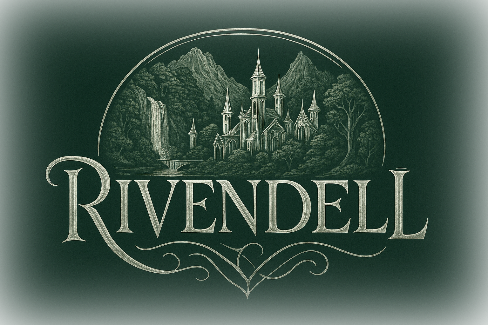
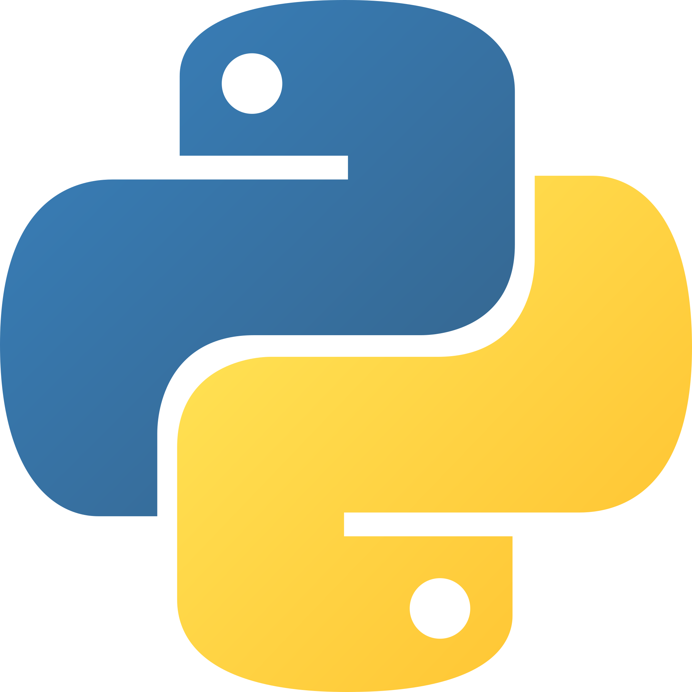
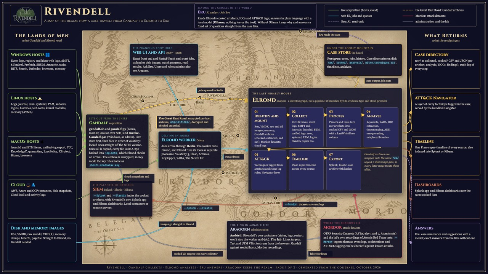
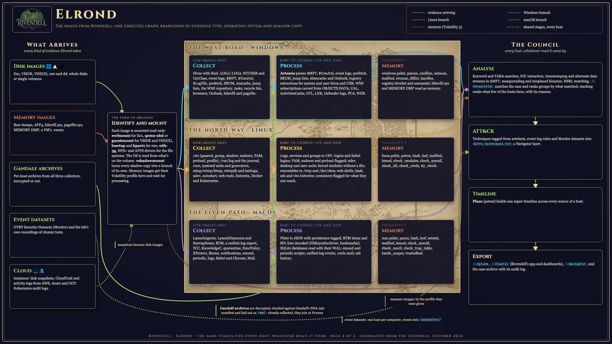
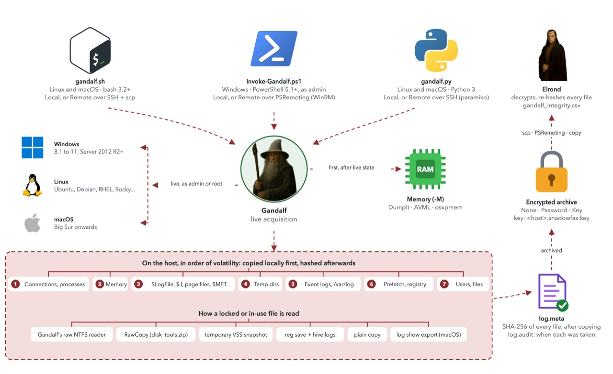
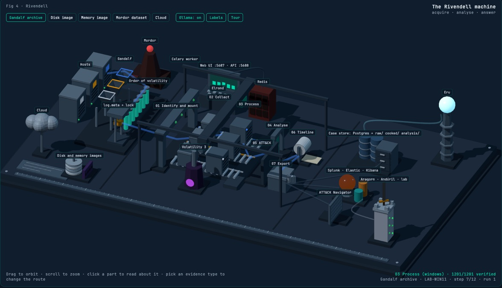

# Rivendell DF Acceleration Suite

<div align="center">
  

  **Digital Forensics Suite v2.1.0**
</div>
<div align="center">
  <i>The Last Homely House</i><br><br>

[](LICENSE)
[](https://www.python.org/downloads/)
[]()
</div>

---

## 🚀 Quick Start

### Installation

```bash
# 1. Clone repository
git clone https://github.com/cmdaltr/rivendell.git
cd rivendell
./rivendell install   # optional: run `rivendell` from anywhere

# 2. Install OrbStack (macOS - RECOMMENDED) or Docker Desktop
# OrbStack: 2-3x faster, uses less RAM, no networking bugs
brew install --cask orbstack

# For other platforms, use the installer:
# python3 scripts/install-rivendell.py

# 3. Configure forensic image paths
python3 scripts/image-paths.py

# 4. Start Rivendell in testing mode
./scripts/start-testing-mode.sh

# 5. Run your first test
cd tests
./scripts/run_single_test.sh win_brisk
```

**📖 [Complete Installation Guide →](INSTALL.md)** - Detailed setup instructions

**💡 Why OrbStack?** On macOS, OrbStack is 2-3x faster than Docker Desktop, uses ~4GB RAM instead of 8-12GB, and has no gVisor networking bugs that cause crashes with large forensic images. It's free for personal use.

### Access Rivendell

- **Web Interface:** http://localhost:5687
- **Backend API:** http://localhost:5688

### Quick Commands

```bash
# Manage forensic image paths
python3 scripts/image-paths.py

# Check job status
./scripts/status.sh

# Stop all jobs
./scripts/stop-jobs.sh

# View logs
docker-compose logs -f backend
```

### System Requirements

| Component | Minimum | Recommended |
|-----------|---------|-------------|
| **RAM** | 10GB | 16GB+ |
| **CPU** | 4 cores | 8+ cores |
| **Disk** | 10GB | 50GB+ |
| **OS** | macOS 12+, Ubuntu 20.04+, Windows 10+ | Latest versions |

**Supported Platforms:**
- macOS (Apple Silicon & Intel)
- Linux (Ubuntu, Debian, Fedora, RHEL, CentOS)
- Windows (with WSL2 recommended)

---

### Basic Usage

**Web Investigation Workflow:**

1. Access web interface at http://localhost:5687
2. Create a new investigation case
3. Upload evidence or configure remote acquisition
4. Monitor processing progress
5. View results, timelines, and ATT&CK mappings
6. Export reports and SIEM data

---

**CLI Investigation Workflow:**

_1. Acquire evidence from remote system_

<div align="left">
  <table><tr><td>
        
      </td><td>
        <code>cd src/acquisition && sudo python3 python/gandalf.py Password Remote -M -O /evidence/CASE-001</code>
      </td></tr><tr><td>
        
      </td><td>
        <code>sudo ./src/acquisition/bash/gandalf.sh Password Remote -h 192.168.1.100 -u administrator -m -o /evidence/CASE-001</code>
      </td></tr><tr><td>
        
      </td><td>
        <code>.\src\acquisition\windows\Invoke-Gandalf.ps1 -EncryptionObject Password -Acquisition Remote -OutputDirectory D:\evidence\CASE-001 -Memory</code>
  </td></tr></table>
</div>

_2. Process and analyze evidence_

`python3 src/analysis/elrond.py CASE-001 /evidence/CASE-001 /cases/CASE-001 --Gandalf --Process --Analysis --Memory`

_3. Additional optional features_
  
&ensp;&ensp;&ensp;Map to MITRE ATT&CK<br>
&ensp;&ensp;&ensp;`python3 -m src.analysis.mitre.coverage_cli report CASE-001 /cases/CASE-001`

&ensp;&ensp;&ensp;Index for AI analysis<br>
&ensp;&ensp;&ensp;`python3 -m src.analysis.rivendell.ai.cli index CASE-001 /cases/CASE-001`

&ensp;&ensp;&ensp;Query with natural language<br>
&ensp;&ensp;&ensp;`python3 -m src.analysis.rivendell.ai.cli query CASE-001 "What PowerShell commands were executed?"`

&ensp;&ensp;&ensp;Generate report<br>
&ensp;&ensp;&ensp;`python3 -m src.analysis.rivendell.ai.cli summary CASE-001 --format markdown --output report.md`

---

## 🌟 Key Features

### 🔍 Comprehensive Forensics Platform

- **Remote Acquisition** - Collect artifacts from remote Windows, Linux, and macOS systems
- **Automated Analysis** - Process evidence with 30+ integrated forensic tools
- **MITRE ATT&CK Integration** - Automatic technique mapping with comprehensive content-based detection and ATT&CK Navigator visualization
- **Cloud Forensics** - AWS, Azure, and GCP investigation support
- **Eru, the AI analyst** - Natural-language questions over a case with a local model (Ollama); fixed questions answered from the case files when there's no model
- **Memory Forensics** - Volatility 3 integration for memory analysis
- **Timeline Generation** - Plaso/log2timeline for comprehensive timelines
- **SIEM Integration** - Direct export to Splunk and Elasticsearch

### 🎯 Architecture

Gandalf acquires, Elrond analyses, Eru answers. Four pictures show how. In the web app they're under **About**; from a shell, `rivendell map realm|elrond|gandalf|machine` opens each one.

<table>
  <tr>
    <td width="50%" valign="top">
      <a href="./src/web/frontend/public/architecture/rivendell-architecture.html"></a><br>
      <b>The realm.</b> The whole platform as a map of Middle-earth: hosts, images and cloud in; Gandalf, the web UI, the Celery worker and Elrond; the case store, SIEM, Navigator, Eru, Aragorn and Mordor.
    </td>
    <td width="50%" valign="top">
      <a href="./src/web/frontend/public/architecture/rivendell-architecture.html"></a><br>
      <b>Elrond's roads.</b> The directed graph: how each evidence type enters, and the Windows, Linux and macOS lanes from Collect through Process and Memory to the shared stages.
    </td>
  </tr>
  <tr>
    <td width="50%" valign="top">
      <a href="./src/web/frontend/public/architecture/gandalf-acquisition.html"></a><br>
      <b>Gandalf's acquisition flow.</b> The three collectors, what each takes in order of volatility, how locked files are read, and how the hashed, encrypted archive reaches Elrond.
    </td>
    <td width="50%" valign="top">
      <a href="./src/web/frontend/public/architecture/rivendell-machine.html"></a><br>
      <b>The Rivendell machine (3D).</b> Every component on one bench. Pick an evidence type and watch its route through Elrond; switch Ollama off to see Eru fall back to fixed answers. Interactive, so open it with <code>rivendell map machine</code> or under About.
    </td>
  </tr>
</table>

The 2D pages are generated by `scripts/docs/architecture/build_map.py` and `build_gandalf_flow.py`; [docs/ARCHITECTURE.md](docs/ARCHITECTURE.md) has the detail.

---

## 📋 Features Overview

### 🧙 Gandalf - Remote Acquisition

Collect forensic artifacts from local and remote systems.

**Features:**
- Multi-platform support (Windows, Linux, macOS)
- Remote acquisition via SSH and PowerShell
- Memory dump collection
- Encrypted evidence packaging
- Live state first, then files in order of volatility; everything copied locally, then SHA-256 hashed into `log.meta`, which Elrond re-checks on arrival
- Audit trail of when each artefact was taken
- Comprehensive artifact collection


**Collected Artifacts:**
- System information
- Running processes
- Network connections
- Registry hives (Windows)
- Event logs (Windows)
- System logs (Linux/macOS)
- Browser artifacts
- User profiles
- Scheduled tasks
- Services
- Memory dumps

[Full Documentation →](docs/CLI.md#gandalf---acquisition)

---

### 🧝‍♂️ Elrond - Automated Analysis

Process and analyze forensic evidence with integrated tools.

**Features:**
- Automated artifact parsing
- Timeline generation with Plaso
- Memory forensics with Volatility 3
- Registry analysis
- Event log parsing
- IOC detection
- Browser artifact extraction
- Multi-OS support (Windows, Linux, macOS)

**Integrated Tools:**
- Volatility 3 (memory analysis)
- Plaso/log2timeline (timeline generation)
- RegRipper (registry parsing)
- Artemis (event logs, $MFT, $UsnJrnl, prefetch, SRUM, jump lists, shimcache)
- YARA and ClamAV (signature scanning)
- The Sleuth Kit, libewf, apfs-fuse (images and file systems)
- 25+ additional forensic utilities

[Full Documentation →](docs/CLI.md#elrond---analysis)

---

### Feature 1: MITRE ATT&CK Integration

Automatically map forensic findings to MITRE ATT&CK techniques with comprehensive content-based detection.

**Features:**
- Auto-updates from MITRE ATT&CK framework (v18.1)
- Content-based pattern matching for accurate technique detection
- 600+ ATT&CK techniques with full descriptions
- Multi-tactic technique support (techniques mapped to all relevant tactics)
- ATT&CK Navigator layer generation with automatic visualization
- Splunk dashboards for each technique with tactic badges
- Comprehensive JSON record scanning (all records, not sampled)
- Large file streaming support for files >10MB

**Usage:**
```bash
# Update MITRE data
python3 -m src.analysis.mitre.cli update

# Map an artefact to techniques
python3 -m src.analysis.mitre.cli map powershell_history -c "<command line>"

# Build dashboards from a mappings file
python3 -m src.analysis.mitre.cli dashboard -i mappings.json -o /output/dashboards
```

**Coverage:**
- 600+ ATT&CK techniques detected
- All 14 tactics covered
- Content-based pattern matching for accurate detection
- Evidence source mapping with full metadata

[Full Documentation →](src/analysis/mitre/README.md)

---

### Feature 2: Coverage Analysis

Real-time MITRE ATT&CK coverage analysis during investigations.

**Features:**
- Standalone coverage analyzer
- Live detection as artifacts are processed
- Integration with Elrond analysis
- SIEM export (Splunk, Elasticsearch)
- Visual coverage dashboards

**Usage:**
```bash
# Start coverage tracking and report
python3 -m src.analysis.mitre.coverage_cli init CASE-001 /cases/CASE-001
python3 -m src.analysis.mitre.coverage_cli report CASE-001 /cases/CASE-001 --detailed

# Generate dashboard
python3 -m src.analysis.mitre.coverage_cli dashboard CASE-001 /cases/CASE-001 -o dashboard.html
```

[Full Documentation →](docs/CLI.md#coverage-analysis-mitrecoverage_cli)

---

### Feature 3: Enhanced Artifact Parsing

Extended support for Windows, macOS, and Linux artifacts.

**Features:**
- **Windows**: WMI persistence detection, scheduled tasks, services
- **macOS**: plists, launch agents/daemons, unified logs, FSEvents
- **Linux**: systemd services, cron jobs, bash history, auth logs

These parsers run as part of Elrond's processing phase; there is no separate command for each.

[Full Documentation →](docs/FUNCTIONALITY.md)

---

### Feature 4: Cloud Forensics

Investigate cloud infrastructure across AWS, Azure, and GCP.

**Features:**
- **AWS**: EC2 snapshots, CloudTrail analysis, S3 forensics
- **Azure**: VM disk snapshots, Activity Log analysis
- **GCP**: Compute Engine snapshots, Cloud Logging analysis
- Unified CLI across all providers
- MITRE ATT&CK mapping for cloud techniques

**Usage:**
```bash
# List AWS instances
python3 -m src.analysis.rivendell.cloud.cli aws list --credentials aws_creds.json

# Acquire Azure VM disk
python3 -m src.analysis.rivendell.cloud.cli azure acquire-disk \
  --instance-id myvm \
  --resource-group mygroup \
  --output ./output

# Analyze CloudTrail logs
python3 -m src.analysis.rivendell.cloud.cli aws analyze-logs \
  --log-file cloudtrail.json \
  --output ./analysis
```

**Detected Techniques:**
- T1078.004 - Cloud Accounts
- T1530 - Data from Cloud Storage
- T1580 - Cloud Infrastructure Discovery
- T1619 - Cloud Storage Object Discovery
- And 13+ more cloud-specific techniques

[Full Documentation →](docs/CLI.md#cloud-forensics)

---

### Feature 5: Eru, the AI Analyst

Query investigation data using natural language with local AI. In the web app, **Ask Eru** talks to Ollama; when Ollama isn't running or the model isn't pulled, Eru says why and offers fixed questions (hosts, techniques, persistence, logins, IOCs, commands) answered straight from Elrond's output. See [docs/ERU.md](docs/ERU.md).

**Features:**
- Natural language queries of forensic data
- Investigation path suggestions
- Automated case summaries
- Web chat interface (port 5687)
- Privacy-focused local LLM (Ollama/LlamaCpp)
- Multi-artifact search (timeline, IOCs, processes, network, registry)

**Usage:**
```bash
# Index case data
python3 -m src.analysis.rivendell.ai.cli index CASE-001 /cases/CASE-001

# Query the case
python3 -m src.analysis.rivendell.ai.cli query CASE-001 "What PowerShell commands were executed?"

# Get investigation suggestions
python3 -m src.analysis.rivendell.ai.cli suggest CASE-001

# Generate case summary
python3 -m src.analysis.rivendell.ai.cli summary CASE-001 --format markdown --output summary.md

# Start web interface (port 5687, same as the frontend container; stop that first)
python3 -m src.analysis.rivendell.ai.web_interface
# Access at http://localhost:5687/ai/chat/CASE-001
```

**Example Queries:**
- "What PowerShell commands were executed?"
- "Show network connections to external IPs"
- "What MITRE ATT&CK techniques were detected?"
- "Summarize the attack timeline"
- "What persistence mechanisms were found?"

[Full Documentation →](docs/ERU.md)

---

## 🛠️ Installation Requirements

**Core Requirements:**
- Python 3.12 (`pyproject.toml` allows 3.8+, but the stack is built and tested on 3.12)
- Volatility 3
- Plaso/log2timeline
- 30+ forensic utilities

**Optional:**
- Ollama (for AI agent)
- Docker (for containerized deployment)
- Splunk/Elasticsearch (for SIEM integration)

**For complete installation guide, see:** [REQUIREMENTS.md](docs/REQUIREMENTS.md)

---

## 📚 Documentation

### Getting Started
- **[Quick Start](docs/QUICKSTART.md)** - Get started in 5 minutes
- **[Usage Guide](docs/USAGE.md)** - Web, API and CLI tasks
- **[CLI Reference](docs/CLI.md)** - Every command, including common workflows
- **[Requirements](docs/REQUIREMENTS.md)** - Installation requirements and dependencies
- **[Performance](docs/PERFORMANCE.md)** - How long each option takes

### User Documentation
- **[Configuration](docs/CONFIG.md)** - Configuration options
- **[API Reference](docs/API.md)** - REST API

### Component Documentation
- **[Functionality](docs/FUNCTIONALITY.md)** - Supported artefact types and parsing
- **[Cloud Forensics](docs/CLI.md#cloud-forensics)** - AWS, Azure, and GCP investigations
- **[Eru](docs/ERU.md)** - AI analyst
- **[SIEM Integration](docs/CLI.md#siem-integration)** - Splunk and Elasticsearch

### Technical Documentation
- **[Architecture](docs/ARCHITECTURE.md)** - Components and job flow
- **[Security](docs/SECURITY.md)** - Security model

---

## 💡 Example Workflows

### Quick Examples

**Incident Response:**
```bash
# Quick triage → Analysis → MITRE mapping → AI query → SIEM export
(cd src/acquisition && sudo python3 python/gandalf.py Password Remote -O /evidence/IR-2024-001)
python3 src/analysis/elrond.py IR-2024-001 /evidence/IR-2024-001 /cases/IR-2024-001 --Gandalf --Process --Analysis --Navigator --Splunk
python3 -m src.analysis.rivendell.ai.cli index IR-2024-001 /cases/IR-2024-001
python3 -m src.analysis.rivendell.ai.cli query IR-2024-001 "What lateral movement occurred?"
```

**Malware Analysis:**
```bash
# Acquire → Memory analysis → IOC extraction → Report
(cd src/acquisition && sudo python3 python/gandalf.py Password Local -M -O /evidence/MAL-001)
python3 src/analysis/elrond.py MAL-001 /evidence/MAL-001 /output/MAL-001 --Gandalf --Process --Memory --extractIocs
python3 -m src.analysis.rivendell.ai.cli index MAL-001 /output/MAL-001
python3 -m src.analysis.rivendell.ai.cli summary MAL-001 --format markdown --output report.md
```

**Cloud Investigation:**
```bash
# Acquire logs → Analyze → Query
python3 -m src.analysis.rivendell.cloud.cli aws acquire-logs --days 30 --output ./logs
python3 -m src.analysis.rivendell.cloud.cli aws analyze-logs --log-file ./logs/cloudtrail.json
python3 -m src.analysis.rivendell.ai.cli index CLOUD-001 ./logs --cloud-logs ./logs/cloudtrail.json --cloud-provider aws
python3 -m src.analysis.rivendell.ai.cli query CLOUD-001 "What suspicious AWS API calls were made?"
```

**For complete workflows, see:** [CLI.md](docs/CLI.md#common-workflows)

---

## 🤝 Contributing

We welcome contributions! Open an issue or pull request at https://github.com/cmdaltr/rivendell.

**Ways to Contribute:**
- Report bugs and request features
- Improve documentation
- Add support for new artifacts
- Develop integrations
- Share use cases and workflows

---

## 📄 License

This project is licensed under the MIT License - see the [LICENSE](LICENSE) file for details.

---

## 🙏 Acknowledgments

Rivendell integrates many excellent open-source forensic tools:

- **Volatility 3** - Memory forensics framework
- **Plaso/log2timeline** - Timeline generation
- **RegRipper** - Registry analysis
- **Artemis** - Windows, Linux and macOS artefact parsing
- **YARA** - Signature scanning
- **The Sleuth Kit** - File system analysis
- **MITRE ATT&CK** - Adversary tactics and techniques
- **Ollama** - Local LLM inference
- **LangChain** - AI orchestration

And 25+ additional tools. See [REQUIREMENTS.md](docs/REQUIREMENTS.md) for the complete list.

---

## 📚 Documentation

### Getting Started
- **[Installation Guide](INSTALL.md)** - Complete setup from git clone to first test
- **[Quick Start](tests/QUICK_START.md)** - Fast track for running tests
- **[Test Runner Guide](tests/docs/TEST_RUNNER_GUIDE.md)** - Comprehensive testing documentation

### Reference
- **[Docker Installation](scripts/DOCKER_INSTALL.md)** - Docker Desktop and OrbStack setup
- **[Gandalf Documentation](docs/CLI.md#gandalf---acquisition)** - Remote acquisition guide
- **[Elrond Documentation](src/analysis/README.md)** - Analysis engine guide
- **[Tools Reference](docs/REQUIREMENTS.md)** - All integrated forensic tools
- **[Troubleshooting](docs/CLI.md#troubleshooting)** - Common problems

---

## 📞 Support

- **Documentation**: See [docs/](docs/)
- **Issues**: [GitHub Issues](https://github.com/cmdaltr/rivendell/issues)
- **Discussions**: [GitHub Discussions](https://github.com/cmdaltr/rivendell/discussions)

---

## 🗺️ Roadmap

**v2.2 (Planned):**
- Mobile device forensics (iOS, Android)
- Network forensics integration
- Automated reporting enhancements
- Additional SIEM integrations

**v2.3 (Future):**
- Collaborative investigation features
- Advanced ML-based anomaly detection
- Container forensics (Docker, Kubernetes)
- Threat intelligence integration

---

## 📊 Project Stats

- **Lines of Code**: 50,000+
- **Integrated Tools**: 30+
- **Supported Platforms**: Windows, Linux, macOS
- **Cloud Providers**: AWS, Azure, GCP
- **MITRE ATT&CK Techniques**: 600+
- **Artifact Types**: 50+

---

**Built with ❤️ for the DFIR community**

[⬆ Back to Top](#rivendell-dfir-suite)
